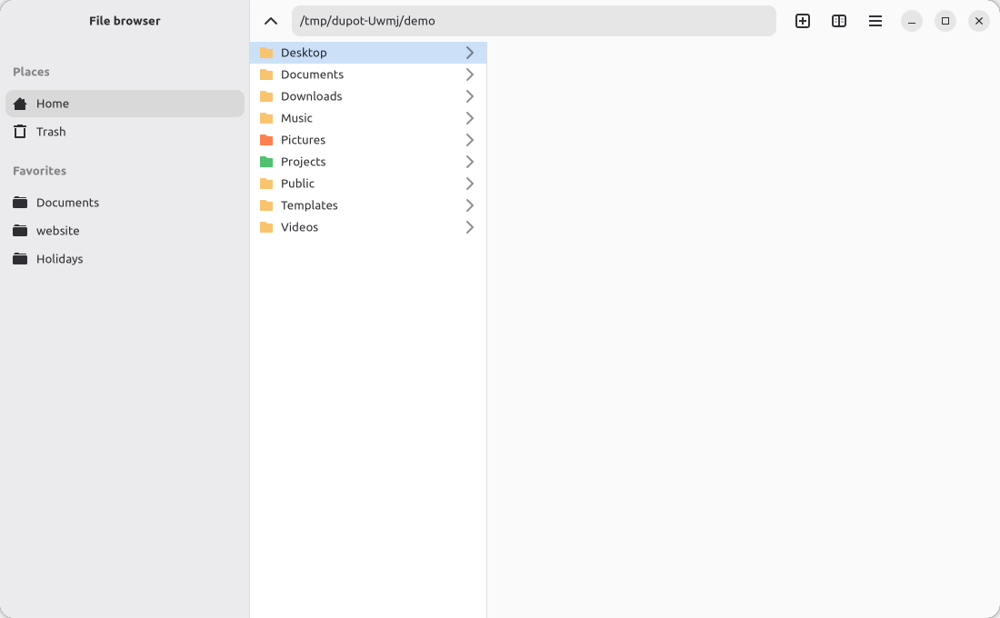
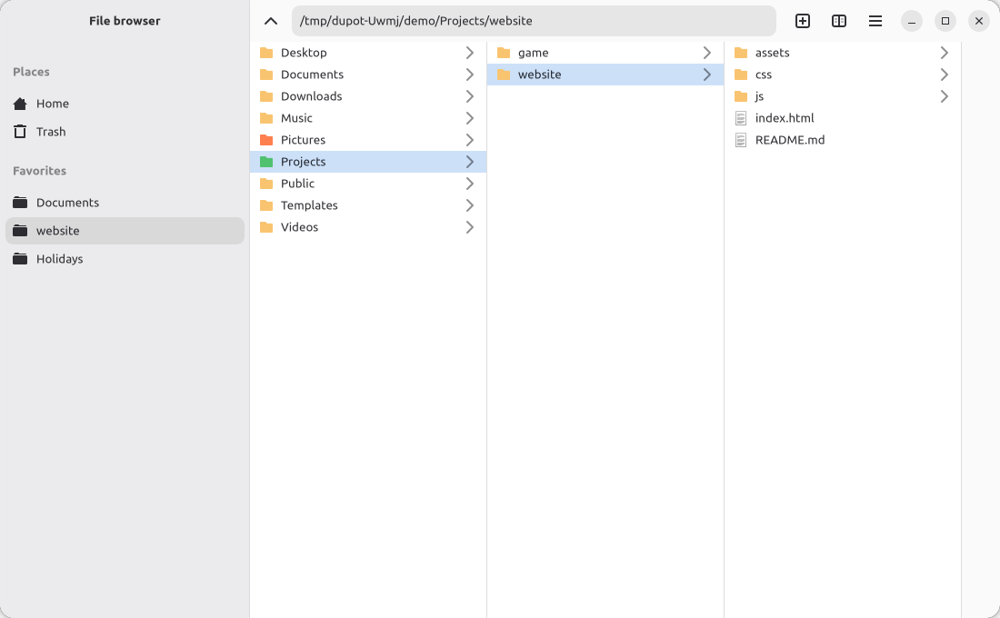
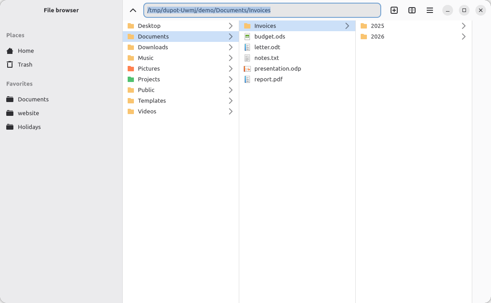
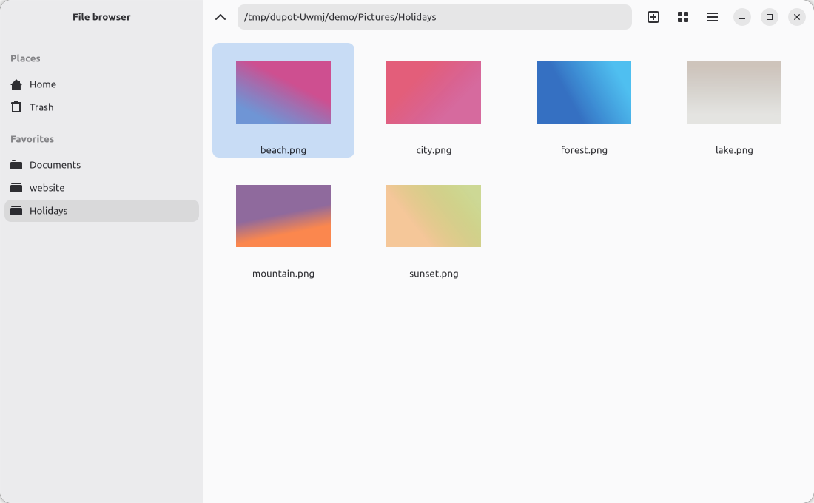
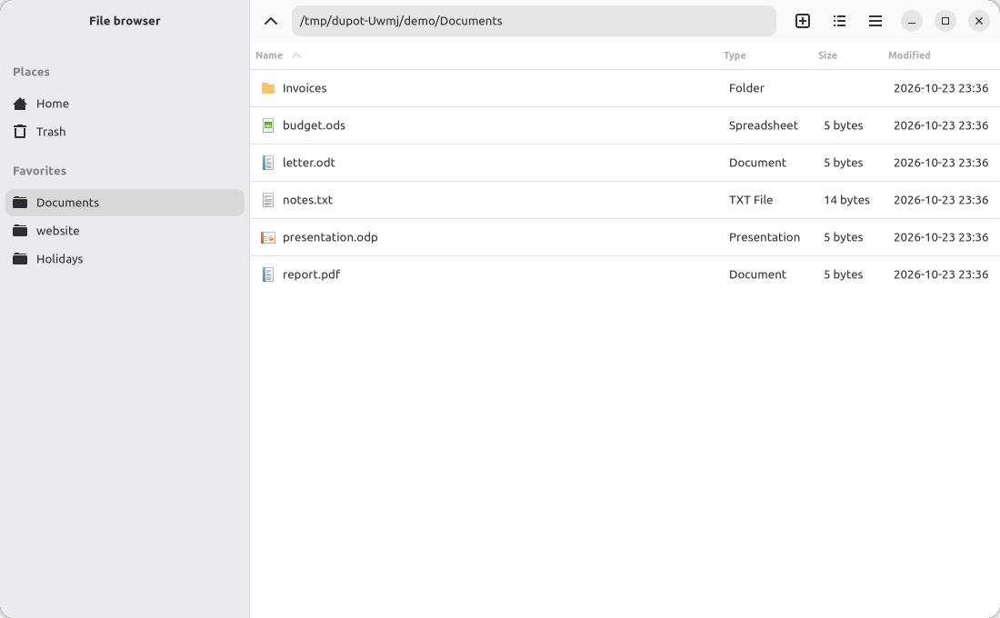
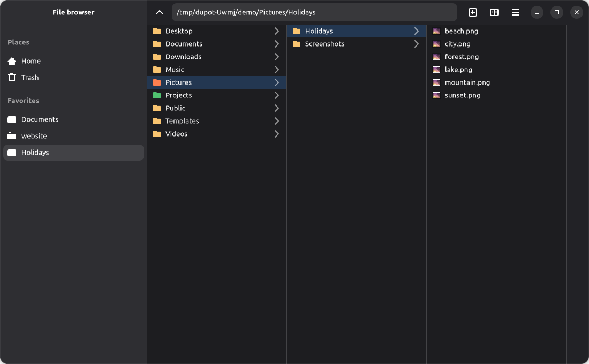
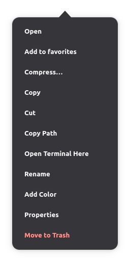
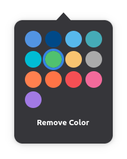
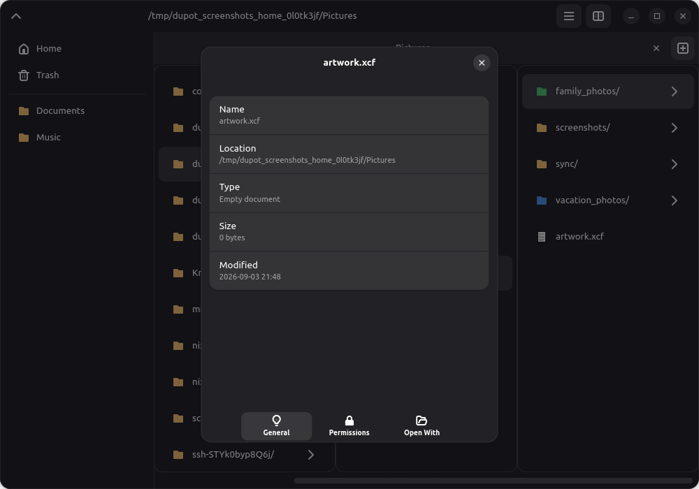
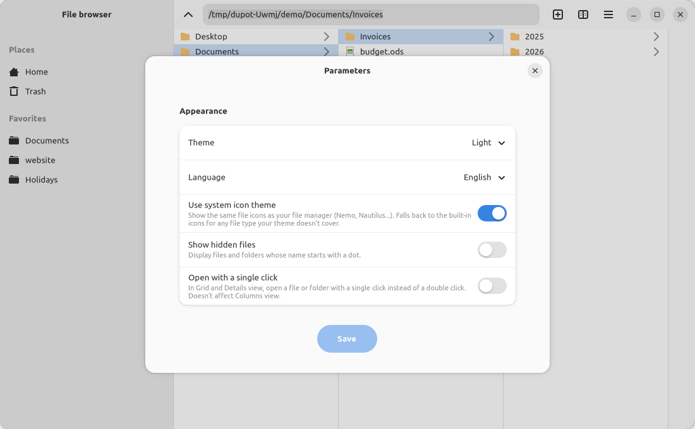

<div align="center">



# dupotFileBrowser

**A simple, lightweight file browser for the Linux desktop.**
Built with Rust, GTK4 and libadwaita — clean, fast, and out of your way.


</div>

---

## Why dupotFileBrowser?

Most file managers try to do everything. dupotFileBrowser focuses on what you
do every day — **finding, opening and organizing your files** — with an
uncluttered GNOME-style interface that feels at home on any modern Linux
desktop.

## ✨ Features

### Navigation
- **Three view modes**: Miller **columns** (the default), **grid** with an
  icon-size slider (great for browsing pictures), and a **details** list
- **Tabs** — open several folders side by side (<kbd>Ctrl</kbd>+<kbd>T</kbd> /
  <kbd>Ctrl</kbd>+<kbd>W</kbd>)
- **Editable path bar** — type a path and press <kbd>Enter</kbd> to jump there
- **Sidebar** with Home, Trash, your favorites, and host `/etc` & `/usr`
  shortcuts (handy inside the Flatpak sandbox)
- Optional **single-click** opening and **hidden-files** toggle

### File operations
- Copy, cut / move, paste, rename, and **move to Trash**
- **Trash page** — restore items or delete them permanently, empty the Trash
- **Compress** files and folders to `.zip`, `.tar`, `.tar.gz`, `.tar.bz2`, `.tar.xz`
- **Extract** archives, including `.rar`
- **Open with…** any application, and set the default app for a file type
- **Open a terminal here** and **copy the path** from the context menu

### Organization & info
- **Color-tag folders** to spot them at a glance
- **Add folders to favorites** in the sidebar
- **Properties dialog**: size (computed for folders), type, dates, owner,
  and editable **permissions**
- **Set an image as wallpaper** straight from its properties

### Look & feel
- Light, dark, or system **theme**
- Baked file-type icons, or your **system icon theme**
- Available in 🇬🇧 English, 🇫🇷 French and 🇮🇹 Italian
- Window size, view mode and preferences are remembered
  (stored under `$XDG_DATA_HOME/org.dupot.filebrowser/`)

## 📸 Screenshots

<table>
<tr>
<td><br><sub>Navigation by column</sub></td>
<td><br><sub>Editable path bar</sub></td>
</tr>
<tr>
<td><br><sub>Grid view</sub></td>
<td><br><sub>Details view</sub></td>
</tr>
<tr>
<td><br><sub>Columns view</sub></td>
<td><br><sub>Folder context menu</sub></td>
</tr>
<tr>
<td><br><sub>Tag a folder with a color</sub></td>
<td><br><sub>File properties</sub></td>
</tr>
<tr>
<td colspan="2" align="center"><br><sub>Parameters</sub></td>
</tr>
</table>

## 🚀 Getting started

### Flatpak

```sh
./build_flatpak.sh      # → export/flatpak/DupotFileBrowser-<version>.flatpak
flatpak install --user export/flatpak/DupotFileBrowser-*.flatpak
flatpak run org.dupot.filebrowser
```

The bundle targets the GNOME 50 runtime; the script installs the SDK and
the Rust extension from Flathub when missing.

### Nix

```sh
nix run github:imikado/dupotFileBrowser   # or `nix build` → result/bin/dupot-file-browser
```

### From source

Needs Rust (edition 2024) and the GTK 4.14+ / libadwaita 1.7+ development
packages, e.g. on Fedora `sudo dnf install gtk4-devel libadwaita-devel`, then:

```sh
cargo run --release
```

## 🛠️ Development

```bash
nix develop        # cargo, clippy, rustfmt, rust-analyzer, gettext + GTK libraries
cargo run          # launch in debug mode
cargo test         # unit tests
cargo clippy --all-targets
```

**VSCode**: open the folder, no need to start it from `nix develop`:

- **F5** debugs, **Ctrl+F5** runs (requires the [CodeLLDB](https://marketplace.visualstudio.com/items?itemName=vadimcn.vscode-lldb) extension)
- tasks for `cargo build`, `run`, `test`, `clippy` (Ctrl+Shift+P → *Run Task*)
- rust-analyzer is started inside the Nix dev shell automatically

All of these go through [`.vscode/nix-cargo.sh`](.vscode/nix-cargo.sh) and [`.vscode/rust-analyzer.sh`](.vscode/rust-analyzer.sh).

### Architecture

Clean architecture in two layers, with unit tests mirroring the sources:

```
src/
├── lib.rs / main.rs
├── assets/                          # app logo, baked file-type icons (embedded in the binary)
├── domain/                          # pure Rust: no GTK, no I/O
│   ├── error.rs                     # DomainError (any library error converts with `?`)
│   ├── entity/                      # file entry, trash entry, properties, file operation, user settings, app info
│   ├── contract/                    # FileSystem, Archive, Trash, ColorTag, Desktop, UserSettings repositories
│   ├── shared/                      # paths, archive formats, Nemo colors, .trashinfo, permissions, shell, .po parsing
│   └── usecase/                     # list a directory, choose a destination (paste, extract, compress, rename)
└── infrastructure/
    ├── api/                         # repositories: std::fs, zip/tar, ~/.local/share/Trash, GVFS metadata, GIO/portal
    ├── service/                     # translations, host commands (flatpak-spawn), GVFS module discovery
    └── ui/                          # GTK / Libadwaita
        ├── app_window.rs            # header bar, sidebar, tabs, paste button and job queue
        ├── browser_tab.rs           # one tab: columns / grid / details / trash views
        ├── path_page.rs, grid_page.rs, details_page.rs, trash_page.rs
        ├── menu/parameters_dialog.rs
        └── shared/                  # context menu, dialogs, icons, sidebar, view switcher

tests/                               # same tree as src/
├── unit.rs                          # single entry point
└── domain/shared/archive.rs         # tests src/domain/shared/archive.rs, …
po/                                  # gettext catalogs (en, fr, it), embedded in the binary
export/flatpak/                      # manifest, desktop file, appdata.xml, icon set
```

**Rules**

- `domain` never depends on `infrastructure`, GTK or the file system; it only gets data in and returns results or `DomainError`.
- Views are thin: they read widgets, call the domain, and display the result.
- Infrastructure is reached through domain contracts, so it can be replaced in tests (see the fake file system in `tests/domain/usecase/`).
- The tests for `src/X.rs` live in `tests/X.rs`.

### Translations

Languages: `en`, `fr`, `it`, in `po/<lang>.po`. The catalogs are embedded
in the binary and parsed at startup: there is no `.mo` to compile.

After adding new `tr("…")` / `trf("…", &[("name", …)])` strings, run (inside
`nix develop`):

```sh
./generate_translations.sh   # extract → po/dupot_file_browser.pot, merge into each .po
```

Strings the domain passes as values (theme/language ids, archive formats,
colors, file types, job errors) aren't seen by `xgettext`; they're listed in
`po/dynamic_hints.pot`. `cargo test` fails if any string lacks a French or
Italian translation.

New languages and translation fixes are very welcome!

### Releasing

The version comes from `Cargo.toml` (keep `export/flatpak/org.dupot.filebrowser.appdata.xml`'s
latest `<release>` in sync). **☰ → About** shows it with the build date and,
under *Troubleshooting*, the package type and platform for bug reports.

## 🤝 Contributing

Bug reports, ideas and pull requests are welcome on
[GitHub](https://github.com/imikado/dupotFileBrowser/issues).

## 📄 License

Released under the [GNU LGPL v2.1](LICENSE).
Made by [Michael Bertocchi](https://www.dupot.org).
